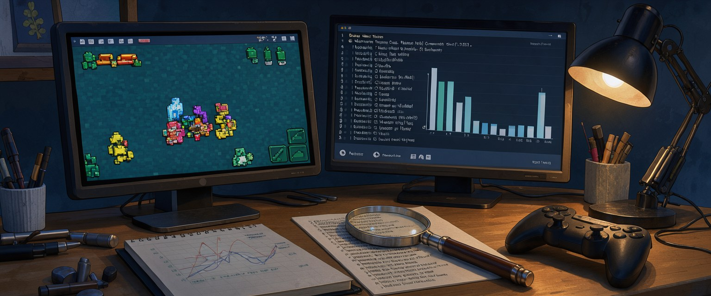

# logwright



Local-first logging, crash reports and play telemetry for games and tools, turned into findings. An agent plugin with one skill and a standard-library script.

- Reads Unity, Minecraft, Bedrock and Roblox logs and crash folders; groups errors by stack signature; warns when a build was never played.
- Turns a play session into findings: crashes, error groups, fails, deaths, quit point, and proposed bug and balance items.
- Gives paste-ready, opt-in, local-only event snippets for Unity, Roblox, Bedrock and browser games, and a privacy check that fails a child's game on any network send.
- Counts a Claude Code session's tool, skill and subagent use, counting each response once and including subagent transcripts.

No network code, no telemetry of its own, nothing sent anywhere.

## Use

```
python scripts/lgw.py query path/to/Player.log --build path/to/Build --md findings.md
python scripts/lgw.py query path/to/session-folder --grind
python scripts/lgw.py agent ~/.claude/projects/<slug>/<session>.jsonl
python scripts/lgw.py privacy path/to/game --child
```

## License

MIT
